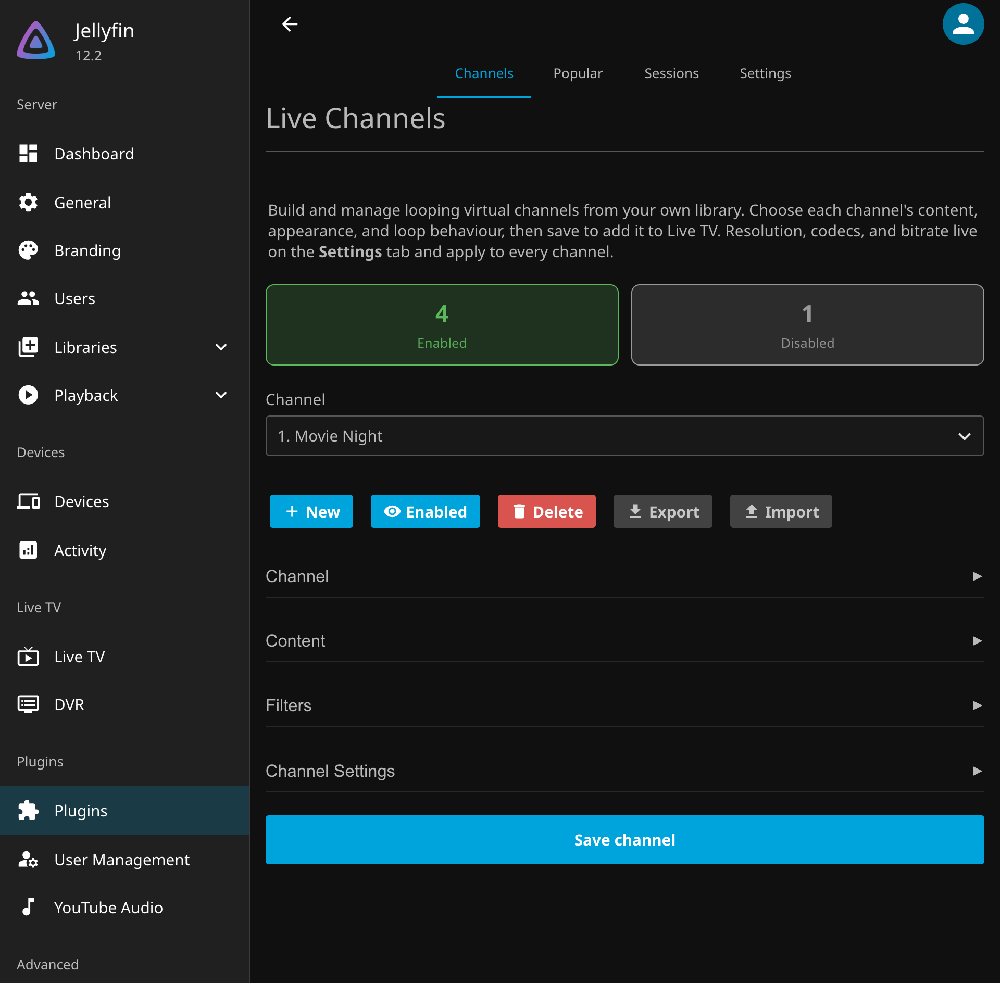
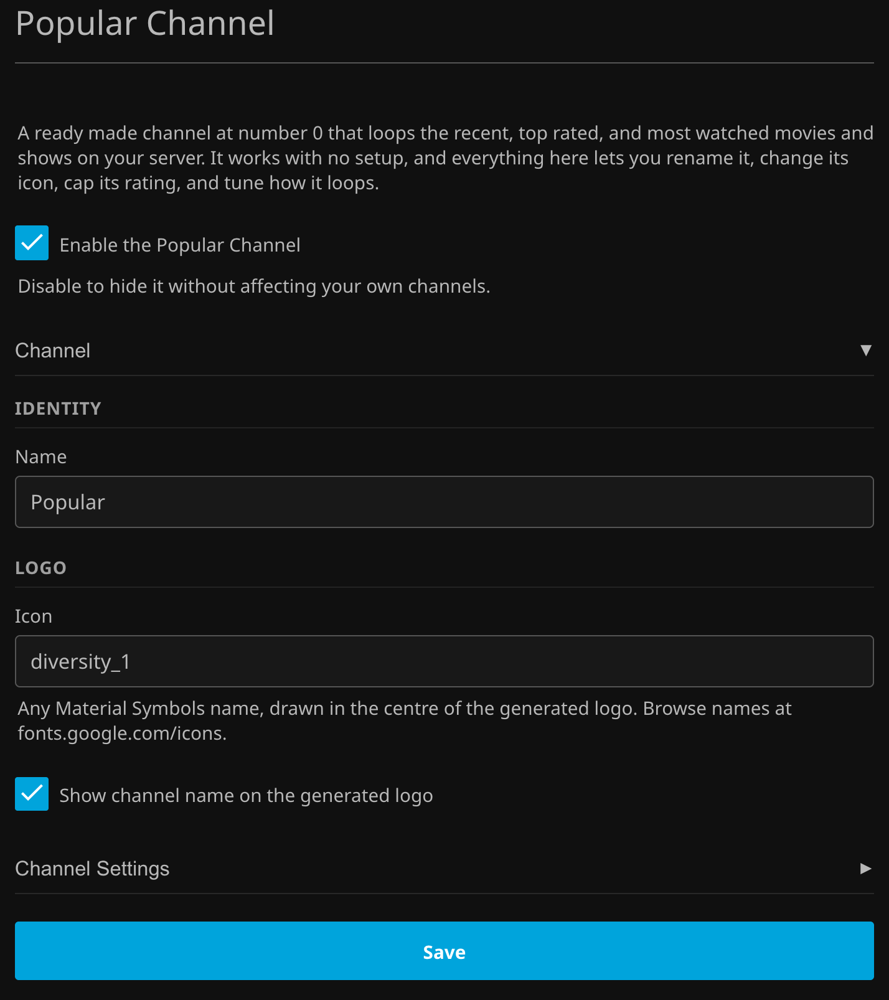
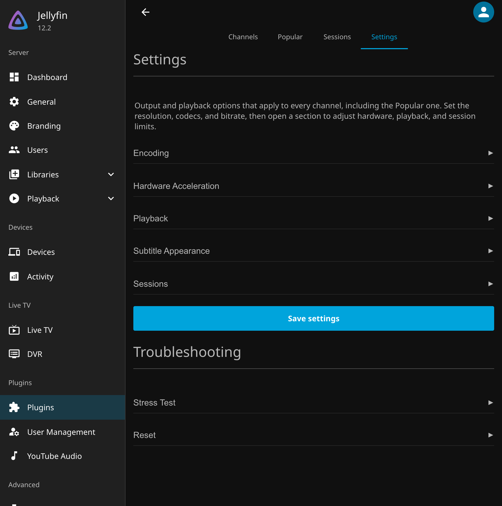
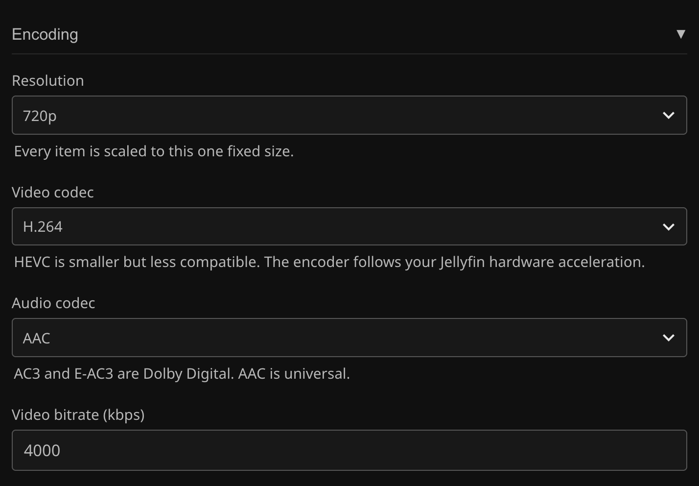
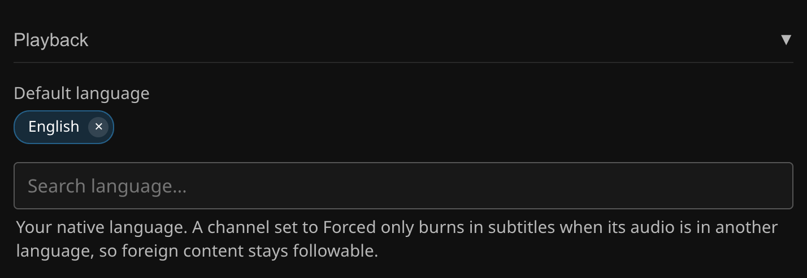

# Settings

Everything the plugin can be told to do, tab by tab. The configuration lives at **Dashboard → Plugins → Live Channels** and has four tabs: **Channels**, **Popular**, **Sessions**, and **Settings**. Every filter is optional and they combine. Leave a filter empty or zero to ignore it.

## Channels tab

### The channel list

The dropdown at the top selects the channel being edited. **New channel** creates one with the next free number, **Delete** removes the selected channel, and the **Enabled** button toggles whether it is served. Disabled channels are absent from Live TV and can be incomplete drafts.

The editor works on a copy. Nothing changes on the server until **Save channel**, and switching to another channel with unsaved edits asks before discarding them. Saving triggers a guide refresh, so edits show up in Live TV right away.

The channel list with its enabled and disabled counts and the editor sections below.

### Channel identity

| Setting | What it does | Default |
| --- | --- | --- |
| **Name** | The channel's display name in the guide. Required. | empty |
| **Channel number** | The guide position. Required for an enabled channel and must be unique. 0 is reserved for the Popular Channel. | next free number |

The Channel section holds the name, number, and logo.

### Logo

| Setting | What it does | Default |
| --- | --- | --- |
| **Logo** (upload) | A custom image, centre-cropped to a square (stored at up to 512 px, 2 MB limit). | none |
| **Generated logo style** | With no upload, the plugin draws a logo: **Number** shows the channel number, **Symbol** shows a Material Symbols icon. | Number |
| **Symbol** | Any [Material Symbols](https://fonts.google.com/icons) name, drawn in the centre for the Symbol style. An unknown name falls back to the number. | empty |
| **Show channel name on the generated logo** | Draws the name along the bottom, wrapped to two lines or abbreviated to initials when long. | on |

The preview in the editor is drawn client side with the same colours and layout the server generates, so what you see is what the guide gets.

### Content sources

A channel plays the union of one or more **sources**. Each source is one of two kinds:

* **Library** narrows one library with a **Selection**:
  * **All content** takes everything in the library.
  * **Genre** takes items carrying any included genre (or every included genre with **Match all genres** on). An **Exclude** list drops items carrying any of those genres even if they matched. Series level genres apply to their episodes.
  * **Whitelist** takes only hand-picked shows and movies. Picking a show pulls in all of its episodes, and a show row expands so individual episodes can be picked instead.
  * **Blacklist** takes everything except the picked items.
* **Collection** takes every item in a Jellyfin collection, expanding a series to its episodes.

A library source using a genre selection.

All channel level filters below still apply on top of every source. Only items with a real media file and a known runtime can be scheduled.

### Filters

The Filters section with two time of day rating blocks.

#### Rating limits

Rating blocks limit which ratings air, optionally by time of day. With no blocks, every rating airs. Each block has:

| Setting | What it does |
| --- | --- |
| **Minimum age rating** | The lowest rating allowed while the block is active, useful for an adults-only channel. |
| **Maximum age rating** | The highest rating allowed, the usual parental cap. |
| **Include unrated** | Whether content with no rating may air under this block. |
| **Tag as kids** | Tags the channel's programs as kids content in the guide while the block is active. |
| **Period** | **All day**, or **Custom** with a start and end time. A custom window may wrap past midnight (22:00 to 06:00 works). |

Where two blocks overlap, the lowest minimum and the lowest maximum win. A channel with any custom (time of day) block schedules itself by the clock, so what airs at 3 PM really is what the daytime block allows.

#### Everything else

| Setting | What it does | Default |
| --- | --- | --- |
| **Transition window (minutes)** | Items starting this close to a rating window change must satisfy both the current and the upcoming window, so long content stays compliant as it bleeds across the boundary. Set it to your longest content. | 0 (off) |
| **Years** | Limit to production years. Enter years and ranges separated by commas, for example `1990-1999` or `1985, 1999, 2003`. Episodes use their own year, so a long-running series contributes only its episodes from those years. | all years |
| **Minimum community rating** | Only content the audience rated at least this, on a 0 to 10 scale (7.5 makes a best-of channel). Content with no community rating is dropped when set. | 0 (off) |
| **Minimum critic rating** | Only content with at least this critic score, on a 0 to 100 scale. Content with no critic rating is dropped when set. | 0 (off) |
| **Studios** | Only content from these studios or networks (an HBO channel). For shows this also matches the series' studio. | all studios |
| **People** | Only content featuring these actors or directors, matched by person. | everyone |
| **Audio language** | Only content with an audio track in this language, and that track is the one that plays. Leave it on all languages and each item plays its audio in your [Default language](#playback) when it has it. | all languages |

### Channel settings

The Channel Settings section covers playback, guide tags, episode grouping, content types, and loop order.

| Setting | What it does | Default |
| --- | --- | --- |
| **Subtitle burn in** | Bakes a subtitle track into the picture for every viewer. **Never** burns nothing. **Forced only** burns the forced track, switching to the full track when the audio is not your [Default language](#playback). **Always** burns the full track on everything. Subtitles come from the same extracted file Jellyfin's own transcodes use, so the track's bold, italic, and colour markup carries into the picture and attached fonts are honoured. Appearance is styled once on the [Settings tab](#subtitle-appearance). | Never |
| **Category** | Tags the whole channel in the guide as **News** or **Sports**. Kids is set per rating block, and the movie tag applies automatically while a movie is playing, so a channel can carry up to three tags at once. | None |
| **Content types** | What airs: **Episodes** (on), **Movies** (on), **Specials** (season 0, off), **Music videos** (on), **Home videos** (off). | see left |
| **Episodes per block** | Consecutive episodes of one series before moving on. 1 disables grouping. | 1 |
| **Keep multipart episodes together** | Holds every part of a multipart story ("The Trap (1)", "(2)", "(3)", and so on) in the same block so it never splits, even when that runs past the episodes per block. | on |
| **Loop order** | **Shuffle** is deterministic and repeatable, so the guide and the stream always agree, and each series contributes one block per loop pass so nothing dominates. **Alphabetical** plays by name. **Chronological** plays oldest to newest by release date. | Shuffle |
| **Episode order** | Within a series, **Air order** or **Random**. | Air order |
| **Favor content type** | On a shuffled channel, weights **Movies**, **Shows**, or **Music videos** more heavily by repeating them toward a target share. | No preference |
| **Favor strength** | How strong that weighting is: **Slight**, **Moderate**, or **Heavy**. Shown once a content type is favored. | Moderate |

### Import and export

**Export** writes every channel (filters, appearance, loop behaviour, and logos) to one JSON file. **Import** merges such a file back: a channel whose number matches an existing one is updated in place, others are added. Library and genre filters carry over when the target server has libraries with matching names, and hand-picked items keep only what exists on the target.

---

## Popular tab

Channel 0 is a built-in channel that programs itself: a de-duplicated mix of the server's recently played, recently added, and highest rated movies and shows, measured across every user, with rotating seeded picks so it stays fresh. Its number and its content sources are fixed. Everything else is configurable and behaves exactly like the matching setting on the Channels tab:

The Popular tab with its Channel section open.

| Setting | Notes | Default |
| --- | --- | --- |
| **Enable the Popular Channel** | Turns channel 0 on or off. | on |
| **Name** | The display name. | Popular |
| **Icon** | A Material Symbols name for the generated logo (this channel always uses the Symbol style). | diversity_1 |
| **Show channel name on the generated logo** | As on the Channels tab. | on |
| **Subtitle burn in** | As on the Channels tab. | Never |
| **Rating limits** and **Transition window** | Rating limits select the population, so the channel keeps the top titles that are valid for the cap. | none |
| **Category** | News or Sports tag. | None |
| **Episodes per block**, **Episode order**, **Keep multipart episodes together** | As on the Channels tab. | 4, Air order, on |
| **Content types** | Episodes, movies, and specials toggles. | episodes and movies on |
| **Loop order** | Shuffle, Alphabetical, or Chronological. | Shuffle |

!!! warning "Privacy and parental controls"
    The Popular channel is built from the watch history of **every user on the server**, and its guide is shared: anyone who can see Live TV sees the same channel 0 lineup, so its recently played picks reveal what other users have been watching. It also has **no per user parental filtering**: the lineup is picked once for everyone, not per viewer, so a title one user's parental controls would hide in the library can still be on air, and the only content limit the channel applies is its own **Rating limits** setting. On a server shared with children or with users who should not see each other's viewing, set a rating limit here or turn the channel off.

---

## Sessions tab

Lists every channel currently encoding, one row per encoder (not per viewer): logo, channel number and name, start time, runtime, and the live encode speed. 1.0x means the server is keeping up, and a session with no viewers shows a countdown until it stops. Selecting a session opens its ffmpeg log with **Refresh**, **Copy**, and **Kill**.

**Kill** stops the stream and frees its encoder immediately, even if someone is watching. It is the only thing that will: the caps and timers below never close a stream Jellyfin reports as playing.

A session's ffmpeg log goes away with the session. When an encoder fails (produces nothing, stops writing for 15 seconds, or exits with an error), a report is also written to Jellyfin's log folder as `livechannels-failure-<time>-<item>.log`, holding the exact ffmpeg command, what happened, and ffmpeg's error. The newest 25 are kept.

---

## Settings tab

Output and playback options that apply to every channel, including the Popular one.

The Settings tab with every section collapsed.

### Encoding

The Encoding section.

| Setting | What it does | Default |
| --- | --- | --- |
| **Resolution** | Every item is scaled and letterboxed to this one fixed size: **720p**, **1080p**, **1440p**, or **4K**. One constant format is what lets a linear stream play seamlessly across items. | 720p |
| **Video codec** | **H.264** (universal) or **HEVC / H.265** (smaller, less compatible). The concrete encoder follows Jellyfin's hardware acceleration. | H.264 |
| **Audio codec** | **AAC** (universal), **AC3**, or **E-AC3** (Dolby Digital). | AAC |
| **Video bitrate (kbps)** | The target and maximum video bitrate. | 4000 |

### Hardware acceleration

The card shows which accelerator channel streams will use, read from Jellyfin's own Playback settings. Encoding follows it for every vendor. Hardware decoding is used with VideoToolbox, QSV, and VA-API (NVENC and AMF accelerate encoding only). On Linux with Intel hardware the whole pipeline runs on the GPU, including HDR tone mapping and subtitle burn in.

The Hardware Acceleration section on a server with no accelerator configured.

| Setting | What it does | Default |
| --- | --- | --- |
| **Disable hardware acceleration** | Forces software encoding and decoding, the one path guaranteed to work on any system, codec, and media type. Turn it on if channels fail to play with hardware acceleration. | off |

### Playback

The Playback section.

| Setting | What it does | Default |
| --- | --- | --- |
| **Default language** | Your native language. Each item plays its audio in it when it has it (the default track in that language, else the first one, else the item's own default track); a channel's **Audio language** overrides it. A channel set to **Forced only** burns full subtitles when content's audio is in another language, so foreign content stays followable. | English |

### Subtitle appearance

How burned-in subtitles look, wherever a channel burns them. Leave everything untouched to render each subtitle exactly as it was authored, including its own bold, italic, and colour tags.

The Subtitle Appearance section with its defaults.

| Setting | What it does | Default |
| --- | --- | --- |
| **Font** | A font family installed on the server, such as Arial. Blank uses the subtitle's own font. | blank |
| **Size (%)** | A percentage of normal, 50 to 300. 100 keeps the authored size. | 100 |
| **Text colour** | The text colour as `#RRGGBB`. Blank keeps the subtitle's own colour. | blank |
| **Outline colour** | The outline or box colour as `#RRGGBB`. | blank |
| **Background** | **As authored**, **Outline**, or **Solid box**. A solid box is the most readable over bright scenes. | As authored |
| **Bold** | Draws the text bold. | off |

### Sessions

The Sessions section caps how many streams encode and where their files go.

| Setting | What it does | Default |
| --- | --- | --- |
| **Maximum concurrent streams** | The most channels that may encode at once. Over the cap, the oldest stream nobody is watching is closed to make room. Streams being watched are never closed for it, so the count can run over while everything is in use. 0 means no limit. The [stress test](#troubleshooting) measures the right value for your server. | 3 |
| **Stream time limit (minutes)** | Closes any stream open longer than this once nobody is watching it, a backstop for clients that never send a stop. 0 turns it off. | 0 |
| **Stream file location** | Where each channel's playlist and rolling stream segments are written while playing, taking effect on restart. Blank uses Jellyfin's cache. Pick a new or empty folder: the plugin cleans up old stream files inside its folder automatically, so it refuses a directory that already contains other content. Only a short rolling window of segments is kept per channel, so disk use stays small regardless of watch time. | blank |

### Troubleshooting

The Stress Test section picks a test item and runs the measurement.

**Stress test.** Measures how many concurrent streams the server can sustain, using the real channel pipeline. Pick one demanding movie or episode (4K or HDR gives the most honest number), then each round encodes a minute of it with one more simultaneous stream than the last, until a stream drops below realtime. The last fully passing round is the recommendation, with an **Apply** link that fills in Maximum concurrent streams for you. The test refuses to start while channel streams are active, and a viewer tuning in cancels it, since a real viewer always wins the encoder. Nothing about the test is saved.

**Reset schedule.** Rebuilds every channel schedule and guide from the current settings by running Jellyfin's own Refresh Guide task. Use it to clear a stale schedule, like after changing a channel's filters.

**Missing media files.** The guide still lists an item whose file was deleted or sits on storage that is offline. When a channel is tuned (or its encoder restarts), it starts on the program the guide shows, steps past a missing item to the next one, and leaves missing files out of the next 24 hours of its playlist. Skipping an item starts the next one early, so the picture can run ahead of the guide by up to the skipped item's length. A file that goes missing more than 24 hours ahead of a viewer who keeps watching can also put the stream out of step until the encoder restarts. A **Reset schedule** after removing or restoring media puts everything back in line.

---

## Recording (DVR)

There are no plugin settings for recording. Timers and series recordings created from the guide work like the built-in DVR: when a program's air window ends, its library file is materialized (hardlinked on the same volume, copied otherwise) into Jellyfin's Live TV recording folders, honouring the recording paths configured at **Dashboard → Live TV → DVR**.
